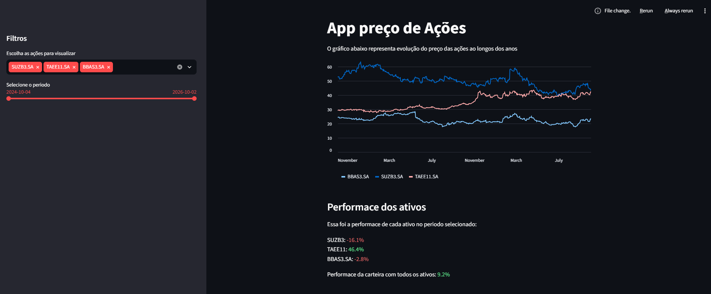

<p align="center">
  
</p>

# 📊 Análise de Ações com Streamlit

Um sistema desenvolvido em Python para análise e acompanhamento de cotações do mercado financeiro em tempo real. O projeto consome dados atualizados das ações diretamente do Yahoo Finance e permite visualizar o histórico de fechamento dos últimos 2 anos em uma interface interativa e intuitiva.

---

## 🛠️ Tecnologias e Bibliotecas Utilizadas

- [Python 3.x](https://www.python.org/) - Linguagem principal do projeto.
- [Streamlit](https://streamlit.io/) - Framework para criação de aplicações web interativas.
- [yfinance](https://pypi.org/project/yfinance/) - Biblioteca para captura de dados do Yahoo Finance.
- [pandas](https://pandas.pydata.org/) - Manipulação e análise de dados estruturados.
- [python-dateutil](https://pypi.org/project/python-dateutil/) - Manipulação e cálculos avançados com datas.

---

## 🚀 Como Baixar e Executar o Projeto

Siga os passos abaixo para rodar o projeto localmente em sua máquina.

### Pré-requisitos

Certifique-se de ter o **Python** (versão 3.8 ou superior) e o **Git** instalados.

### 1. Clonar o repositório

```bash
git clone https://github.com/IMoisasZ/analise_acoes_streamlit.git
cd analise_acoes_streamlit
```

### 2. Criar e ativar um ambiente virtual (Opcional, mas recomendado)

- **Windows:**
  ```bash
  python -m venv env
  .\env\Scripts\activate
  ```
- **Linux/macOS:**
  ```bash
  python3 -m venv env
  source env/bin/activate
  ```

### 3. Instalar as dependências

Você pode instalar as dependências de duas formas:

**Opção A: Utilizando o arquivo `requirements.txt`**

```bash
pip install -r requirements.txt
```

**Opção B: Instalando as bibliotecas manualmente**

```bash
pip install streamlit yfinance pandas python-dateutil
```

### 4. Executar a aplicação

```bash
streamlit run app.py
```

---

## 👨‍💻 Autor

- **Autor:** Moisés Santos
- **GitHub:** [@IMoisasZ](https://github.com/IMoisasZ)
- **E-mail:** [mopri08@gmail.com](mailto:mopri08@gmail.com)
